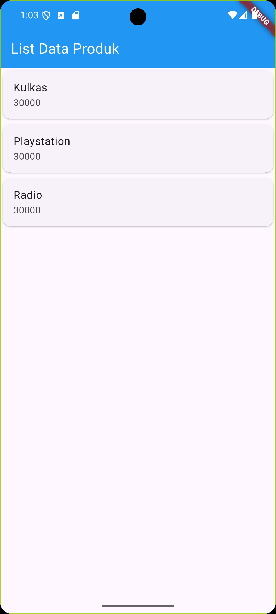
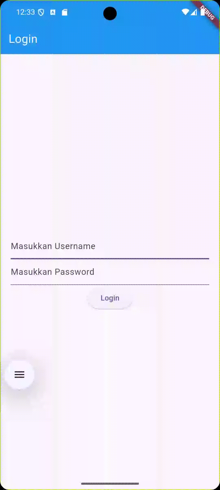

# Tugas Praktikum Pemrograman Mobile - Implementasi Queue (Antrian)

Repository ini berisi implementasi struktur data **Queue (Antrian)** berbasis konsep **FIFO (First In, First Out)** menggunakan bahasa pemrograman **Dart**.

---

## Identitas Mahasiswa

- **Nama** : Zaki Fatah Alfikri
- **NIM** : H1D024124
- **Shift Awal** : I
- **Shift Sekarang** : B

---

## Deskripsi Singkat

Struktur data **Queue** adalah kumpulan elemen berurutan di mana penambahan elemen baru dilakukan di bagian belakang (*tail*) dan pengambilan/penghapusan elemen dilakukan di bagian depan (*head*). Konsep ini mengikuti prinsip **FIFO (First-In, First-Out)**, yaitu elemen yang pertama kali dimasukkan akan menjadi elemen yang pertama kali keluar.

Program dibuat menggunakan **Generics (`Queue<T>`)** agar fleksibel dan dapat digunakan untuk berbagai tipe data (misalnya integer, string, objek, dll).

---

## Penjelasan Kode (`queue.dart`)

1. **Kelas `Queue<T>`**
   - Mendefinisikan antrian generik dengan list privat `_items` untuk menampung elemen-elemen antrian.
2. **Metode `enqueue(T item)`**
   - Menambahkan elemen baru ke urutan paling belakang antrian menggunakan `_items.add(item)`.
   - Mencetak pesan konfirmasi ke konsol bahwa data berhasil ditambahkan.
3. **Metode `pop()`**
   - Mengambil dan menghapus elemen paling depan antrian menggunakan `_items.removeAt(0)` sesuai aturan FIFO.
   - Mencetak pesan konfirmasi ke konsol bahwa data telah dihapus dari antrian.
   - Jika antrian kosong, menampilkan pesan peringatan dan mengembalikan `null`.
4. **Metode & Properti Pendukung**
   - `isEmpty` & `isNotEmpty`: Mengecek status kekosongan antrian.
   - `length`: Mengetahui jumlah elemen dalam antrian.
   - `peek()`: Melihat elemen paling depan tanpa menghapusnya.
   - `display()` / `tampilkan()`: Menampilkan isi antrian saat ini (`Isi antrian: [...]`).
   - `clear()`: Mengosongkan seluruh antrian.
5. **Fungsi `main()`**
   - Membuat instance objek antrian integer `Queue<int>()`.
   - Menambahkan elemen `10`, `20`, dan `30` ke dalam antrian menggunakan `enqueue()`.
   - Menampilkan kondisi antrian saat ini menggunakan `display()`.
   - Menghapus elemen paling depan (`10`) menggunakan `pop()`.
   - Menampilkan kembali kondisi antrian setelah penghapusan.

---

## Cara Menjalankan Program

### Prasyarat
- **Dart SDK** sudah terpasang di sistem. Pastikan dengan perintah:
  ```bash
  dart --version
  ```

### Menjalankan Program
1. Buka terminal pada folder proyek:
   ```bash
   cd "D:\Praktikum Pemob"
   ```
2. Jalankan perintah berikut:
   ```bash
   dart run queue.dart
   ```

---

## Output Program

Berikut adalah hasil *output* saat program dijalankan:

```text
10 berhasil ditambahkan ke antrian
20 berhasil ditambahkan ke antrian
30 berhasil ditambahkan ke antrian
Isi antrian: [10, 20, 30]
10 dihapus dari antrian
Isi antrian: [20, 30]
```

---

# IMPLEMENTASI FLUTTER

Implementasi tugas dan latihan praktikum Pemrograman Mobile menggunakan framework Flutter pada direktori `belajarflutter/`.

### Modul 2: Pengenalan dan Desain Framework Flutter
1. **Hello World (`lib/hello_world.dart`)**: Dasar pembuatan tampilan dengan `StatelessWidget`, `Scaffold`, dan `Center`.
2. **Column Widget (`lib/column_widget.dart`)**: Penataan tata letak (layout) secara vertikal (`Column`).
3. **Row Widget (`lib/row_widget.dart`)**: Penataan tata letak secara horizontal (`Row`).
4. **Form Produk & Detail (`lib/ui/produk_form.dart` & `lib/ui/produk_detail.dart`)**: Input data produk (`TextField`), `StatefulWidget`, serta perpindahan halaman dan pengiriman data menggunakan `Navigator.push`.
5. **List Data Produk (`lib/ui/produk_page.dart`)**: Menampilkan daftar item menggunakan `ListView`, `Card`, dan `ListTile`.

#### Display Modul 2
<p align="center">
  
</p>

---

### Modul 3: Routes, Side Menu, Login dan Local Storage
1. **Login Page (`lib/login_page.dart`)**:
   - Autentikasi simulasi username dan password (`admin` / `admin`).
   - Menyimpan session login username ke penyimpanan lokal (*local storage*) menggunakan `shared_preferences`.
   - Menampilkan `AlertDialog` konfirmasi status login dan navigasi ke halaman tujuan.
2. **Home Page (`lib/home_page.dart`)**:
   - Menampilkan pesan selamat datang dengan nama user (`Ini adalah halaman User $namauser`) yang dimuat secara asinkron dari `shared_preferences`.
   - Memiliki tombol drawer untuk membuka menu navigasi samping (*side menu*).
3. **Side Menu / Drawer (`lib/sidemenu.dart`)**:
   - Menu navigasi samping menggunakan widget `Drawer`, `DrawerHeader`, dan `ListTile`.
   - Navigasi rute ke halaman `HomePage` dan `AboutPage`.
4. **About Page (`lib/about_page.dart`)**:
   - Halaman informasi aplikasi yang juga dilengkapi dengan menu samping (*side menu*).

#### Display Modul 3
<p align="center">
  
</p>
