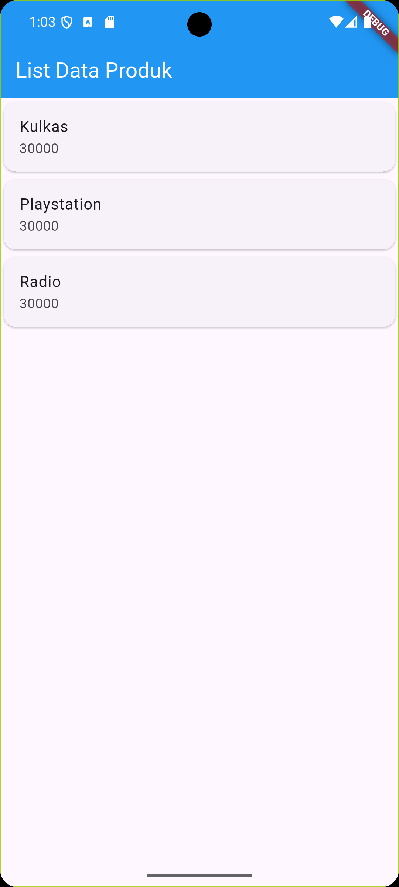

# belajarflutter

A new Flutter project for Mobile Programming Practicum.

---

# IMPLEMENTASI FLUTTER

Implementasi tugas dan latihan praktikum Pemrograman Mobile menggunakan framework Flutter pada direktori `belajarflutter/`.

### Modul 2: Pengenalan dan Desain Framework Flutter
1. **Hello World (`lib/hello_world.dart`)**: Dasar pembuatan tampilan dengan `StatelessWidget`, `Scaffold`, dan `Center`.
2. **Column Widget (`lib/column_widget.dart`)**: Penataan tata letak (layout) secara vertikal (`Column`).
3. **Row Widget (`lib/row_widget.dart`)**: Penataan tata letak secara horizontal (`Row`).
4. **Form Produk & Detail (`lib/ui/produk_form.dart` & `lib/ui/produk_detail.dart`)**: Input data produk (`TextField`), `StatefulWidget`, serta perpindahan halaman dan pengiriman data menggunakan `Navigator.push`.
5. **List Data Produk (`lib/ui/produk_page.dart`)**: Menampilkan daftar item menggunakan `ListView`, `Card`, dan `ListTile`.

#### Display Modul 2

  

---

### Modul 3: Routes, Side Menu, Login dan Local Storage
1. **Login Page (`lib/login_page.dart`)**:
   - Autentikasi simulasi username dan password (`admin` / `admin`).
   - Menyimpan session login username ke penyimpanan lokal (*local storage*) menggunakan `shared_preferences`.
   - Menampilkan `AlertDialog` konfirmasi status login dan navigasi ke halaman tujuan.
2. **Home Page (`lib/home_page.dart`)**:
   - Menampilkan pesan selamat datang dengan nama user (`Ini adalah halaman User $namauser`) yang dimuat secara asinkron dari `shared_preferences`.
   - Memiliki tombol drawer untuk membuka menu navigasi samping (*side menu*).
3. **Side Menu / Drawer (`lib/sidemenu.dart`)**:
   - Menu navigasi samping menggunakan widget `Drawer`, `DrawerHeader`, dan `ListTile`.
   - Navigasi rute ke halaman `HomePage` dan `AboutPage`.
4. **About Page (`lib/about_page.dart`)**:
   - Halaman informasi aplikasi yang juga dilengkapi dengan menu samping (*side menu*).
